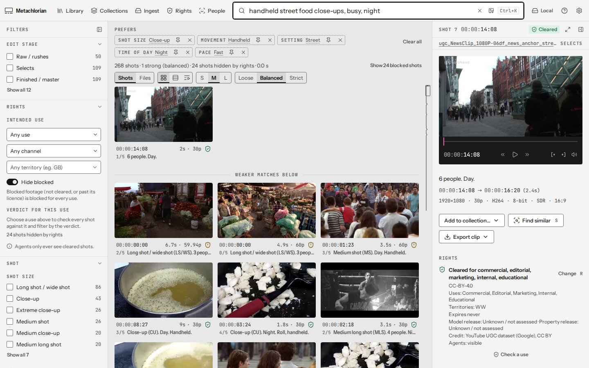
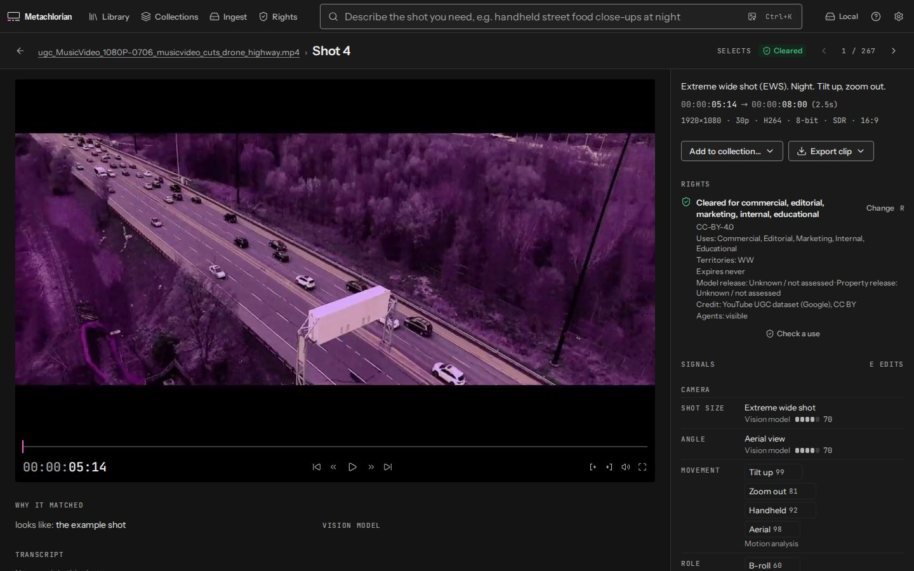
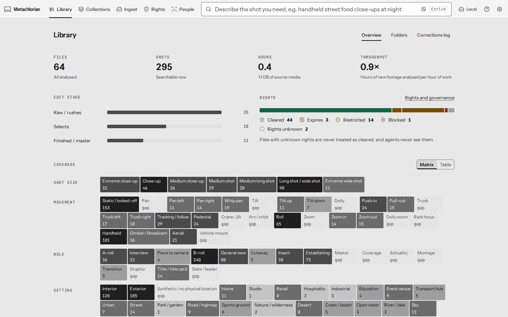
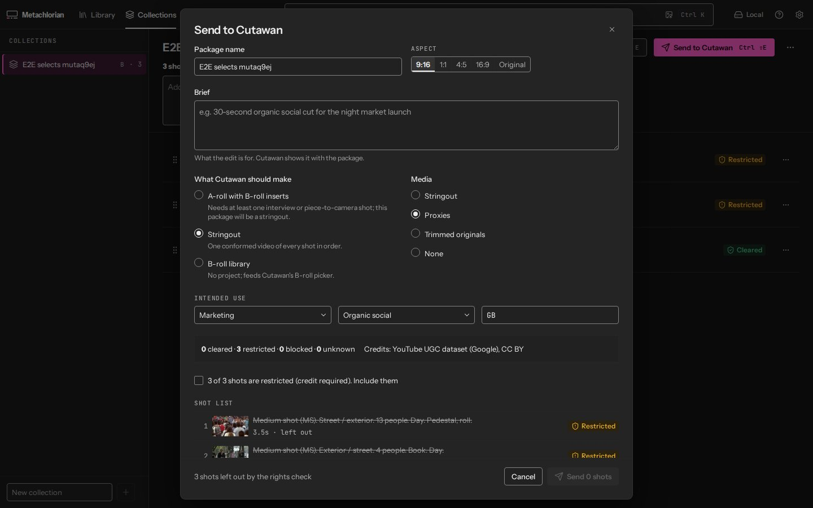

# Metachlorian: open-source video search

**Find the exact shot in your video library.** Metachlorian indexes footage on your own computer so you can find B-roll
by what a shot shows, search words in transcripts and on-screen text, and send selected shots to your editor.
Use the desktop or web app yourself, or connect an AI agent through MCP or the REST API.

[Website](https://www.metachlorian.xyz) · [Try it on one folder](#try-it-on-one-folder) · [Connect an AI agent](#connect-your-agent-mcp) · [Documentation](docs/architecture.md)

## Download

Free and open source under Apache-2.0. The desktop app includes Python, the Metachlorian engine, FFmpeg and the web app.

| Platform | Download v0.1.0 |
|---|---|
| Windows (x64) | [Windows installer (.exe)](https://github.com/JeremySNR/Metachlorian/releases/download/v0.1.0/Metachlorian-Setup-0.1.0.exe) |
| macOS (Apple Silicon) | [Mac disk image (.dmg)](https://github.com/JeremySNR/Metachlorian/releases/download/v0.1.0/Metachlorian-0.1.0-arm64.dmg) |
| Linux (x64) | [Linux AppImage](https://github.com/JeremySNR/Metachlorian/releases/download/v0.1.0/Metachlorian-0.1.0.AppImage) |

[Release notes and all downloads](https://github.com/JeremySNR/Metachlorian/releases/latest) · [Docker and source installation](#quick-start)

The first launch downloads about **1.7 GB of analysis models**, once. Local analysis needs no paid API key; processing
time depends on your hardware and footage. Windows builds are unsigned; macOS builds are ad-hoc signed and not notarised.
See the [desktop setup notes](#quick-start) for first-launch prompts.

## Try it on one folder

1. **Add a small folder of footage you know.** Open the app and choose **Add a folder**, or use **Ingest and processing**.
   Start with a few short clips; originals stay where they are.
2. **Let analysis run, then search.** Check progress in **Ingest and processing**. Try a visual description such as
   `wide coastline at sunset`, or words spoken in an interview. Results improve as analysis finishes.
3. **Preview the matching shots.** Review their timecodes and match explanations, save a collection, and export selected
   shots as clips or an OTIO, FCPXML or EDL timeline. Record the footage's rights before a rights-checked export.

Local and personal files are excluded from community contributions. **New YouTube imports share machine metadata
with a public community index by default**; turn off **Settings → Community sharing** before importing private or unlisted
videos. [Sharing details and opt-out](#community-sharing).

> "Slow, wide drone shots of a coastline at golden hour, no people, at least 8 seconds, 4K."
> "Wide shots of Lisbon we're cleared to use on paid social."

Results include shot in/out points and match explanations. When you specify an intended use, rights filtering uses the
licence and clearance information recorded in your library.

## What you can do

- **Built for agents.** An MCP server and REST API that work with Claude, Codex, Cursor and any MCP client. Read-only by
  default, scoped tokens for anything more, every call audited.
- **Measured, not guessed.** Shot boundaries, camera motion, pace, loudness and image quality are computed. Models are
  used for meaning: what's in the shot, what's said and when, what's written on screen, who is in it.
- **Straight to the timeline.** Hand selected shots to [Cutawan](https://github.com/JeremySNR/cutawan), or to any editor
  that reads OpenTimelineIO, FCPXML or CMX 3600 EDL.
- **Self-hosted and open source (Apache-2.0).** Runs on a CPU, faster with a GPU. Footage, frames and faces stay on your
  machine unless an admin chooses a hosted model. One exception is on by default: new YouTube imports share machine
  metadata with a public community index ([details and opt-out](#community-sharing)).
- **A web and desktop app for people too.** Search, review what the index says about each shot, and correct it.

[](review/m4/screens/01-search-results--desktop-light.jpg)

If Metachlorian helps you find footage, [star the repository](https://github.com/JeremySNR/Metachlorian) to help other
editors and developers discover it. [Report a problem](https://github.com/JeremySNR/Metachlorian/issues) if something gets
in the way.

## Why index video before searching?

Metachlorian analyses footage at import and stores the results. People and agents can then query that index instead of
running video analysis again for each search. Reprocessing is available when models, settings or your corrections change.

| Capability | What you get |
|---|---|
| Search an existing index | Median 325 ms at 1.6 million shots in the [reference benchmark](eval/README.md); performance varies by library and hardware |
| Local analysis | No paid model API required; hosted providers are optional |
| Shot-level results | Shot boundaries and word-timed speech help you locate the matching moment |
| Inspectable records | Signals include their source, confidence and model version; human corrections take precedence |
| Recorded rights | Filter for an intended use using the clearance information you supply |

## Connect your agent (MCP)

Start the server, create a token in **Settings → Agents** (or `metachlorian token my-agent`), then add it to your MCP
client:

```json
{
  "mcpServers": {
    "metachlorian": {
      "type": "http",
      "url": "http://127.0.0.1:8765/mcp/",
      "headers": { "Authorization": "Bearer mc_xxxxxx_..." }
    }
  }
}
```

On the same machine, `metachlorian mcp` runs over stdio instead (read-only without a token).

An illustrative agent workflow for selecting holiday footage looks like this (folder names and results depend on your library):

1. `list_folders(query="disney")` → `Holidays/Disney 2026` (41 files, 2.3 h)
2. `search_shots(query="kids on a ride, smiling", folder="Disney 2026", filters={"min_duration": 2})`
3. `find_similar(shot_id=<best one>, folder="Disney 2026")` for more like it
4. `build_package(items=[...], name="Disney rides 60s")` → a package Cutawan or any editor can open

Exporting requires the `media:export` scope and recorded rights that permit the intended use. A package is a hand-off for
editing, not a finished video. Tools for search, shot and file records, similar shots, rights checks, clip export, packages,
folders, collections, people and vocabularies are listed with their scopes in [docs/agents.md](docs/agents.md).

## What it indexes

- **Shots, not files.** Every file is split into shots (hard cuts, dissolves, fades) and long takes into segments, each
  with its own record.
- **How it was filmed.** Shot size, camera angle and movement (from optical flow), lens, depth of field, lighting, colour
  grade, speed effects, resolution, frame rate, HDR and log.
- **What it shows.** SigLIP embeddings and zero-shot labels for setting, time of day, weather, season and mood; objects,
  people and on-screen text (OCR); optional dense captions from a vision-language model.
- **What is said.** Speech with word timings (Parakeet), speaker turns, audio events and loudness (EBU R128).
- **What it's for.** Shot role, pace, cuts per minute, usability, and whether a file is a raw take, selects or a finished
  edit.
- **Who is in it.** Faces are recognised across shots and files, locally. Name someone once and "Maria laughing in the
  kitchen" finds them. Merge, split or forget people at any time.
- **Rights you record.** Source, licence, permitted uses, channels, territories, expiry and releases per file
  (overridable per shot). State an intended use to filter against those records. Metachlorian does not independently
  verify ownership or establish permission to reuse footage.

Search blends visual semantic similarity, keywords in transcripts and on-screen text, and label matches. Speech and OCR
search match words; they do not currently offer meaning-level retrieval of paraphrases. Natural language is
parsed into filters you can see and edit, and every result says *why* it matched. Query by example with a shot, a still
or a clip. Corrections are stored separately from machine output and win over it, even after re-processing.

Footage can come from folders, S3 buckets, or web links: paste YouTube, Vimeo or other links (or a whole playlist) and
they are downloaded with yt-dlp and analysed like everything else, with rights starting as unknown. Hosted models
(an OpenAI API key, OpenRouter, or a ChatGPT subscription via the Codex CLI) can add richer captions once an admin enables
one; provider charges or subscription limits may apply.

## Screenshots

| | |
|---|---|
|  |  |
| Search: the query becomes editable chips; every result explains why it matched | Shot detail: each signal shows its source and confidence; corrections are marked human |
|  |  |
| Library overview: edit stage, rights, coverage gaps | Collections go to Cutawan or out as OTIO / FCPXML / EDL |

All journeys, at desktop, laptop and tablet sizes in light and dark: [review/m4](review/m4/index.md).

## Quick start

**Server or NAS (Docker):**

```bash
git clone https://github.com/JeremySNR/Metachlorian && cd Metachlorian
METACHLORIAN_ADMIN_PASSWORD='choose-a-long-password' FOOTAGE_DIR=/path/to/footage \
  docker compose -f deploy/docker-compose.yml up -d
# open http://<host>:8765 and sign in as admin
```

**One command (Linux/macOS, Docker or native):**

```bash
curl -fsSL https://raw.githubusercontent.com/JeremySNR/Metachlorian/main/scripts/install.sh | bash
```

**From source (solo mode on your machine):**

On Linux or macOS, install Git, FFmpeg, Node.js/npm and uv, then create a source checkout and build it:

```bash
git clone https://github.com/JeremySNR/Metachlorian && cd Metachlorian
cd app && npm ci && npm run build
cd ../core && uv venv -p 3.11 && uv pip install -e ".[analysis]"
.venv/bin/metachlorian models fetch            # downloads the local analysis models
.venv/bin/metachlorian serve --add ~/Footage   # keep running; open http://127.0.0.1:8765
```

**Desktop app (Windows x64, macOS Apple Silicon, Linux x64):** download the installer from the [releases page](https://github.com/JeremySNR/Metachlorian/releases)
and open it. It includes everything (its own Python, the core, FFmpeg and the web app), so nothing else needs installing. The
first launch downloads the analysis models (about 1.7 GB, once). In solo mode it runs the library on your computer; in team
mode it connects to a shared server. It adds native drag-out of real clip files and one-click hand-off to Cutawan. Installers
are unsigned on Windows and ad-hoc signed, without notarisation, on macOS (see [OPEN_QUESTIONS.md](OPEN_QUESTIONS.md)): on macOS use **System Settings → Privacy & Security → Open
Anyway** the first time; on Windows choose **More info → Run anyway**. From source: `cd desktop && npm ci && npm start`.

## Community sharing

Metachlorian can also search a public [community index](https://metachlorian-community.vercel.app) of analysed YouTube
videos and open results at the matching timestamp.

YouTube imports have a separate, default-on sharing setting from hosted model analysis. After analysis finishes,
the app sends only the machine metadata allowlist and download title/channel/licence/duration to the community service.
Videos, frames, audio files and complete library records are never contributed. Local and personal files, local
duplicates, human notes and face identities are excluded.

**Warning: video visibility is not checked.** Private, unlisted or sensitive YouTube imports can publish their titles,
descriptions, transcripts and on-screen text. Turn off **Settings → Community sharing** before importing them if you
want that metadata to stay private. Published metadata can remain searchable after the original video becomes private
or is deleted. Opting out stops pending contributions; it does not remove already published metadata.

The default service is `https://metachlorian-community.vercel.app`; its [source and deployment guide](https://github.com/JeremySNR/Metachlorian-community)
live in a separate repository and database. No YouTube API key or Google Cloud setup is required.
Community search sends your query to that service and opens results at matching YouTube timestamps.
Analysis and contributor-reported licences may be wrong and do not establish reuse rights.
The community operator can remove a video from the index.

Turn sharing off in **Settings → Community sharing**, or set `METACHLORIAN_COMMUNITY_ENABLED=false` before starting the app.
`METACHLORIAN_COMMUNITY_URL` selects a self-hosted service (HTTPS required except on loopback).
Videos imported while sharing is off are never backfilled; turning it off also suppresses pending updates.
Only newly downloaded YouTube bytes are enrolled, so existing libraries, local/personal files, other websites and local
duplicates are never uploaded automatically. Replaced or deleted downloads are excluded.
Network failures leave contributions pending for retry; local analysis continues normally.
`metachlorian community-sync` retries a bounded batch without running the web server.

## Hardware tiers

| Tier | What runs | Speed (this build's reference box: 4 vCPU, no GPU) |
|---|---|---|
| CPU only | Everything except VLM captions: shots, motion, quality, audio, speech, OCR, people, embeddings, zero-shot labels, rules-based fusion | **1.7 hours of footage per hour** with 3 workers; search median 325 ms at 1.6 M shots ([eval](eval/README.md)) |
| Single consumer GPU (8–12 GB) | Adds a local VLM (Qwen3.5 4B/9B via llama.cpp or Ollama) for dense captions and LLM fusion; ONNX models use CUDA | GPU numbers to be measured by maintainers (no GPU in the build environment) |
| Multi-GPU / server | Several workers (`workers = N`), a larger VLM, team mode with many users | scales with workers |

## How it fits together

```
 folders / S3 ──▶ ingest (hash, dedupe, ffprobe) ──▶ job queue (SQLite, resumable, versioned analysers)
                                                         │
     technical → proxy → shots → keyframes → embed → zero-shot tags
                                     ├─▶ motion, quality, people, OCR
                                     └─▶ audio → speech ──▶ caption (VLM, optional) ──▶ fusion ──▶ rollup
                                                         │
                         SQLite (records, FTS5) + usearch HNSW (vectors) ──▶ hybrid search
                                                         │
                       REST API · MCP server · web app · Electron shell · Cutawan / OTIO / FCPXML / EDL
```

Read more: [architecture](docs/architecture.md) · [decision records](docs/decisions) · [design system](docs/design/system.md) ·
[evaluation](eval/README.md) · [licences](docs/licences.md) · [Cutawan hand-off](docs/integration/cutawan-contract.md) ·
[plan](PLAN.md) · [roadmap](docs/roadmap.md) · [open questions](OPEN_QUESTIONS.md).

## Licence

Apache-2.0. Model weights have their own licences (all permit commercial use); see [docs/licences.md](docs/licences.md) and
[NOTICE](NOTICE).
